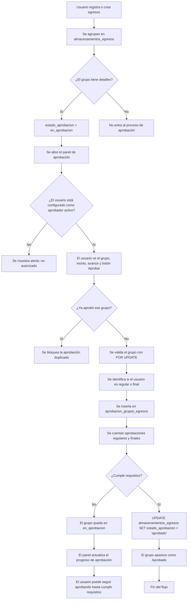

# Flujo de aprobación de egresos

## Resumen

Este flujo describe cómo un grupo de egresos pasa de estar pendiente a quedar aprobado en el panel de aprobación del sistema.

## Diagrama de flujo

## Regla de aprobación aplicada

La lógica actual exige:

- 3 aprobaciones regulares
- 1 aprobación final

Esto se define en `config/aprobaciones.php` y se usa en la pantalla `aprobacion.php`.

## Secuencia de ejecución real

1. Los egresos se agrupan en `almacenamientos_egresos`.
2. Si el grupo tiene detalles, el sistema marca `estado_aprobacion = 'en_aprobacion'`.
3. El panel carga todos los grupos que estén en `en_aprobacion` o `aprobado`.
4. El usuario autorizado presiona "Aprobar grupo".
5. El sistema valida:
   - que el usuario pueda aprobar,
   - que el grupo exista,
   - que esté todavía en aprobación,
   - que no haya votado previamente.
6. Se registra el voto en `aprobacion_grupos_egresos`.
7. El sistema cuenta los votos por tipo.
8. Si se alcanzan los requisitos, el grupo cambia a `aprobado`.
9. Si no, sigue en `en_aprobacion`.

## Tablas clave

- `almacenamientos_egresos`
  - guarda el grupo principal
  - tiene el campo `estado_aprobacion`

- `aprobacion_grupos_egresos`
  - guarda cada aprobación individual por usuario
  - tiene `id_almacenamiento`, `id_usuario`, `es_final`, `fecha_aprobacion`

- `aprobadores_egresos`
  - define quienes tienen permiso para aprobar
  - indica si cada aprobador es regular o final

## Puntos importantes

- La aprobación se hace a nivel de grupo, no por egreso individual.
- Se usa una validación de bloqueo (`FOR UPDATE`) para evitar doble registro concurrente.
- El panel visualiza progreso con porcentaje y estado del grupo.

## Archivos relevantes

- [aprobacion.php](aprobacion.php)
- [config/aprobaciones.php](config/aprobaciones.php)
